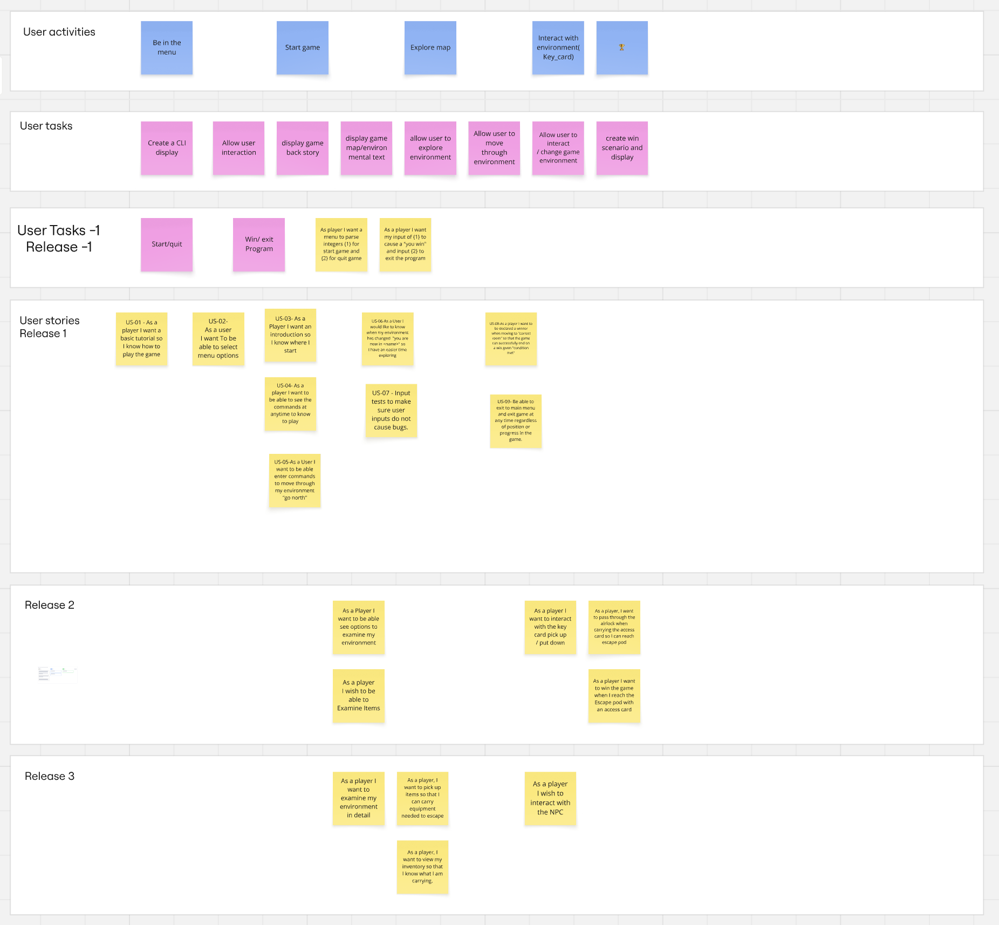
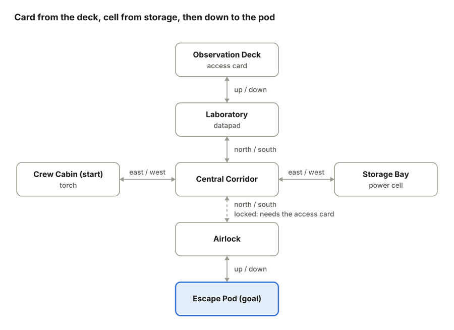

# stranded_station

# Commands Reference

Use the following commands while playing the game:

## Help

| Command | Description |
|----------|-------------|
| `h` | Display the help menu and show all available commands. |

## Movement

| Command | Description |
|----------|-------------|
| `go north` ⬆️ | Move north |
| `go south` ⬇️ | Move south |
| `go east` ➡️ | Move east |
| `go west` ⬅️ | Move west |
| `go up` 🔼 | Move up |
| `go down` 🔽 | Move down |

## Item Interaction

| Command | Description |
|----------|-------------|
| `take` | Pick up items |
| `drop` | Drop items from your inventory |
| `look` | Observe your surroundings |
| `examine <item name>` | View detailed information about certain items you have collected |

## Utility Commands

| Command | Description |
|----------|-------------|
| `m` 🗺️ | Display the map |
| `q` | Exit the game |

## Notes

- Additional commands and gameplay features will be added in future releases.
- Some items can be examined after being collected using the `examine <item name>` command.

---

## Doc Images

